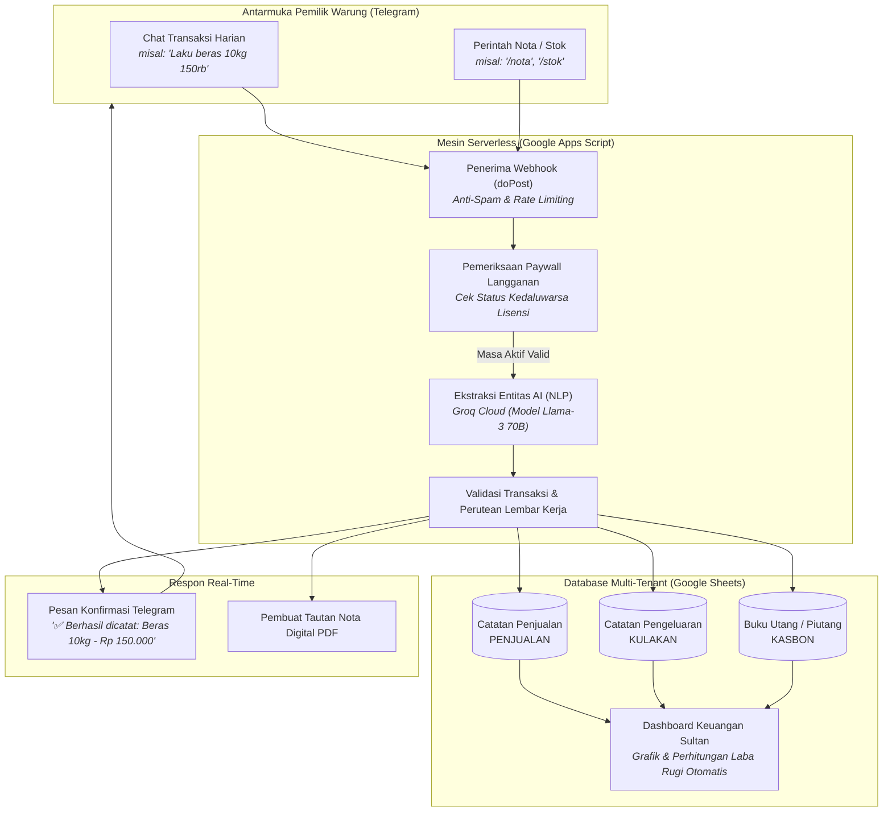

<div align="center">

# 🤖 LimBot

**Sistem Kasir & Pembukuan Otomatis Micro-SaaS Berbasis Telegram & AI untuk Warung dan UMKM**

[](package.json)
[](https://developers.google.com/apps-script)
[](https://groq.com)
[](https://core.telegram.org/bots/api)
[](#-keunggulan-arsitektur--bisnis)
[](LICENSE)

*Bahasa Indonesia — [Read this in English](README.md)*

</div>

---

## 📌 Ringkasan Eksekutif

**LimBot** adalah produk **Micro-SaaS Kasir & Pembukuan Digital** tanpa server (*serverless*) yang dirancang khusus untuk pemilik warung sembako, toko kelontong, agen, dan pedagang mikro.

Alih-alih menggunakan aplikasi kasir layar sentuh yang rumit atau software mahal, pemilik warung cukup mencatat seluruh transaksi harian secara santai melalui percakapan chat di **Telegram** (contoh: *"Laku beras 10kg 150rb"*, *"Bayar sales indomie 50rb"*, *"Bu Ani ngutang telur 20rb"*).

Di balik layar, model **Meta Llama-3 (melalui Groq Cloud)** membaca bahasa percakapan sehari-hari dan mengekstraknya menjadi data transaksi JSON terstruktur, yang langsung dicatat secara *real-time* ke **Dashboard Google Sheets** masing-masing warung lengkap dengan grafik laba rugi, rekapan pengeluaran, dan buku kasbon.

---

## 🏗️ Arsitektur Sistem & Alur Aliran Data



---

## ⚡ Keunggulan Arsitektur & Bisnis

- **Biaya Server Rp 0 / Bulan (*Zero-Server Cost*)**: Berjalan sepenuhnya di atas infrastruktur serverless Google Apps Script dan Google Sheets, menghilangkan biaya sewa VPS atau database cloud bulanan.
- **Pemahaman Bahasa Slang & Singkatan Warung**: Arsitektur prompt khusus pada Groq Llama-3 yang mengenali singkatan pasar lokal Indonesia (contoh: `mnyk` = minyak, `brs` = beras, `rb` = ribu, `utang/kasbon` = piutang).
- **Pabrikasi Bot Otomatis (`LimBotFactory.js`)**: Skrip *infrastructure-as-code* berbasis `@google/clasp` untuk membuat, mengompilasi, mendeploy, dan menyambungkan webhook bot baru untuk klien dalam waktu **kurang dari 30 detik**.
- **Agen Otonom Rantai Pasok (`AgentOtonom_Stok.js`)**: Buku kas stok waktu-nyata (`Total Masuk - Total Keluar`), normalisasi kamus SKU, buffer hari aman (*safety stock*), dan pembuatan draf *Purchase Order* (PO) otomatis ke pemasok.
- **Database Mandiri (*Self-Healing Storage*)**: Menggandakan master template spreadsheet, membersihkan data simulasi (*auto-clean*), dan menyetel mata uang Rupiah (`IDR`) secara otomatis pada transaksi pertama klien.

---

## 🚀 Panduan Memulai Cepat

### 1. Prasyarat Sistem
- Node.js `>= 18.0.0`
- Token Bot Telegram (dibuat via [@BotFather](https://t.me/BotFather))
- Groq Cloud API Key (dibuat via [Groq Console](https://console.groq.com))
- Akun Google terautentikasi melalui `@google/clasp`:
  ```bash
  npx @google/clasp login
  ```

### 2. Pemasangan

```bash
# Salin repositori
git clone https://github.com/alimmiftah32-glitch/LimBot.git
cd LimBot

# Pasang dependensi
npm install
```

### 3. Mencetak Bot Baru untuk Klien (Pabrik)

Jalankan perintah pabrikasi otomatis:

```bash
npm run factory -- "<TOKEN_TELEGRAM_KLIEN>" "<GROQ_API_KEY>"
```

Mesin pabrik akan otomatis:
1. Menyiapkan kontainer Google Apps Script baru.
2. Menyuntikkan template transaksi V16 dengan token klien.
3. Melakukan deploy Web App production ke Google server.
4. Menyambungkan webhook langsung ke server Telegram.

### 4. Aktivasi Lisensi

1. Buka URL Apps Script yang dicetak di terminal dan jalankan fungsi `setupAwal` sekali untuk menyetujui izin OAuth.
2. Di dalam chat bot Telegram klien, aktifkan masa berlaku langganan:
   ```
   /perpanjang 30 admin123
   ```
3. Serahkan bot ke pemilik warung. Transaksi pertama yang dikirimkan klien akan otomatis membuatkan dashboard spreadsheet pribadi mereka!

---

## 📂 Struktur Direktori Repositori

```
├── LimBotFactory.js        # CLI pabrik otomatis pembuat bot klien
├── TemplateSembako.js      # Kode mesin transaksi utama Google Apps Script V16
├── AgentOtonom_Stok.js     # Agen otonom manajemen stok & rantai pasok
├── rebuild_bot.bat         # Skrip batch rebuild deployment cepat
├── buka_editor_manual.bat  # Peluncur cepat Google Apps Script web editor
├── docs/                   # Dokumentasi teknis & SOP bisnis
│   ├── SYSTEM_BLUEPRINT.md # Blueprint arsitektur & alur transaksi menyeluruh
│   ├── FACTORY_OPERATIONS.md# SOP operasional admin mencetak bot klien
│   ├── CS_PLAYBOOK.md      # Panduan CS & teknik mengatasi keberatan harga
│   └── user_guide.html     # Buku saku visual interaktif untuk pedagang
├── package.json            # Definisi proyek Node.js & CLI script
├── .env.example            # Template variabel lingkungan
└── LICENSE                 # Lisensi Open Source MIT
```

---

## 📖 Dokumentasi Arsitektur Mendalam

- [**Blueprint & Arsitektur Sistem**](docs/SYSTEM_BLUEPRINT.md)
- [**SOP Operasional Pabrik Bot**](docs/FACTORY_OPERATIONS.md)
- [**Playbook Customer Success & Edukasi Klien**](docs/CS_PLAYBOOK.md)

---

## 📄 Lisensi

Didistribusikan di bawah Lisensi MIT. Lihat [LICENSE](LICENSE) untuk rincian selengkapnya.
