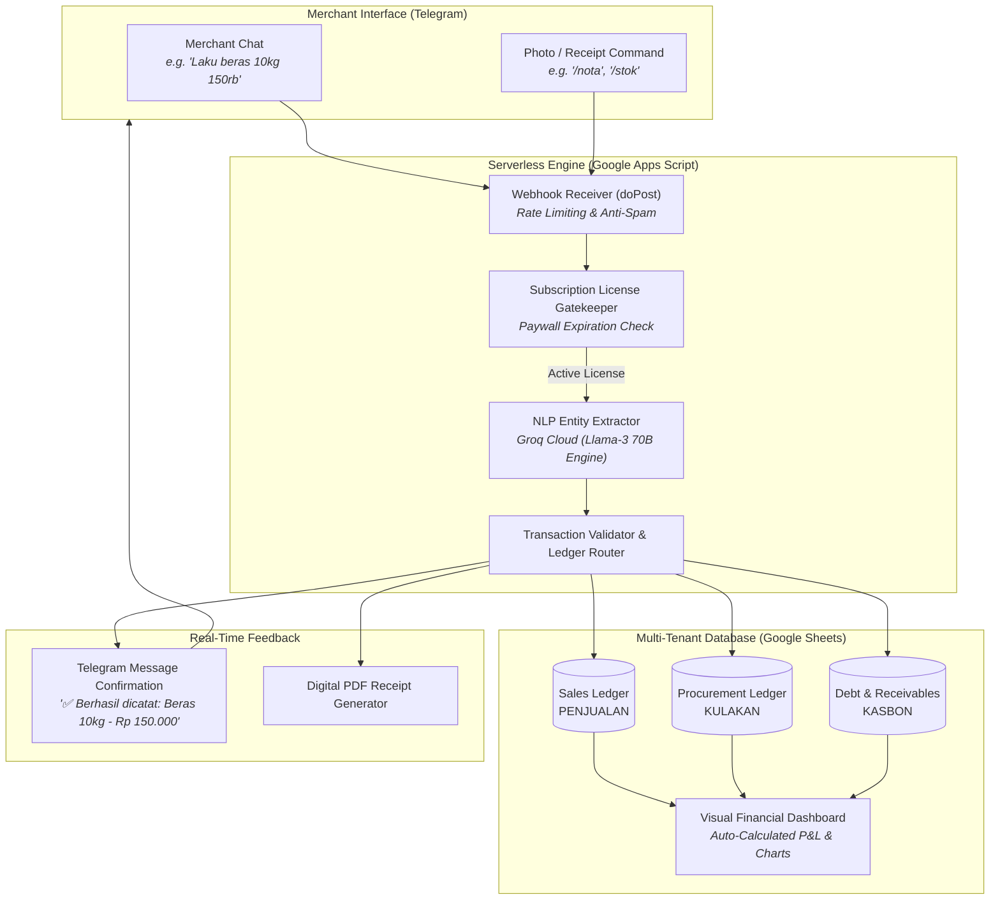

<div align="center">

# 🤖 LimBot

**Serverless Telegram Micro-SaaS POS & Autonomous Inventory Engine for Micro-Retail**

[](package.json)
[](https://developers.google.com/apps-script)
[](https://groq.com)
[](https://core.telegram.org/bots/api)
[](#-architecture--value-proposition)
[](LICENSE)

*English — [Baca dalam Bahasa Indonesia](README.id.md)*

</div>

---

## 📌 Executive Summary

**LimBot** is a production-ready, cloudless **Micro-SaaS POS and Bookkeeping system** tailored for micro-retailers, neighborhood grocers (*warung kelontong*), and informal merchants.

Instead of navigating complicated POS touchscreens or installing bloated software, merchants record daily transactions naturally via conversational chat in **Telegram** (e.g., *"Laku beras 10kg 150rb"*, *"Bayar sales indomie 50rb"*, *"Bu Ani ngutang telur 20rb"*).

Under the hood, **Meta Llama-3 (via Groq Cloud)** parses colloquial Indonesian dialect into strongly-typed transactional JSON, which streams directly into private, auto-provisioned **Google Sheets dashboards** with instant gross profit, expense, and debt reconciliation.

---

## 🏗️ System Architecture & Workflow



---

## ⚡ Key Engineering & Business Highlights

- **Zero Infrastructure Hosting Cost ($0/Month)**: Built entirely on serverless Google Apps Script webhooks and Google Sheets storage, eliminating VPS/cloud database monthly overhead.
- **Colloquial Dialect Parsing (SLANG NLP)**: Fine-tuned prompt architecture on Groq Llama-3 to resolve Indonesian merchant shorthand (e.g., `mnyk` = minyak, `brs` = beras, `rb` = ribu, `utang/kasbon` = receivables).
- **Automated Factory CLI (`LimBotFactory.js`)**: An infrastructure-as-code CLI that utilizes `@google/clasp` to provision, compile, push, deploy, and bind Telegram webhooks for new clients in **under 30 seconds**.
- **Autonomous Supply Chain Agent (`AgentOtonom_Stok.js`)**: Real-time stock ledger computing `Total Inflow - Total Outflow`, automated SKU dictionary normalization, lead time safety buffers, and auto-generated supplier Purchase Orders (PO).
- **Self-Healing Multi-Tenant Storage**: Automatically clones master spreadsheet templates, purges dummy data, and binds regional currency (`IDR`) on first transaction.

---

## 🚀 Quickstart

### 1. Prerequisites
- Node.js `>= 18.0.0`
- Telegram Bot Token (from [@BotFather](https://t.me/BotFather))
- Groq Cloud API Key (from [Groq Console](https://console.groq.com))
- Google Account authenticated via `@google/clasp`:
  ```bash
  npx @google/clasp login
  ```

### 2. Installation

```bash
# Clone the repository
git clone https://github.com/alimmiftah32-glitch/LimBot.git
cd LimBot

# Install developer dependencies
npm install
```

### 3. Provisioning a Client Bot Instance

Run the automated factory CLI:

```bash
npm run factory -- "<TELEGRAM_BOT_TOKEN>" "<GROQ_API_KEY>"
```

The factory engine will automatically:
1. Initialize an isolated Google Apps Script container.
2. Inject template code with client tokens.
3. Deploy the Google Web App production endpoint.
4. Bind the webhook to Telegram servers.

### 4. License Activation

1. Open the Apps Script URL output in the terminal and execute the `setupAwal` function once to grant OAuth permissions.
2. In the client Telegram chat, activate the paywall duration:
   ```
   /perpanjang 30 admin123
   ```
3. Hand the bot over to the merchant. The first recorded transaction automatically provisions their private financial dashboard!

---

## 📂 Repository Layout

```
├── LimBotFactory.js        # Automated factory CLI for provisioning bot instances
├── TemplateSembako.js      # Master Google Apps Script V16 core transactional engine
├── AgentOtonom_Stok.js     # Autonomous supply chain & inventory replenishment agent
├── rebuild_bot.bat         # Automated rebuild & fresh deployment batch script
├── buka_editor_manual.bat  # Fast-launcher for Google Apps Script web editor
├── docs/                   # Product & Engineering documentation
│   ├── SYSTEM_BLUEPRINT.md # Comprehensive system blueprint & transaction flow
│   ├── FACTORY_OPERATIONS.md# Standard Operating Procedures for bot deployment
│   ├── CS_PLAYBOOK.md      # Sales playbook & merchant objection handling
│   └── user_guide.html     # Interactive merchant visual handbook
├── package.json            # Node.js project definition & CLI scripts
├── .env.example            # Environment variables template
└── LICENSE                 # MIT Open Source License
```

---

## 📖 Deep Dive Documentation

- [**System Blueprint & Architecture**](docs/SYSTEM_BLUEPRINT.md)
- [**Factory Deployment Operations (SOP)**](docs/FACTORY_OPERATIONS.md)
- [**Customer Success & Sales Playbook**](docs/CS_PLAYBOOK.md)

---

## 📄 License

Distributed under the MIT License. See [LICENSE](LICENSE) for details.
