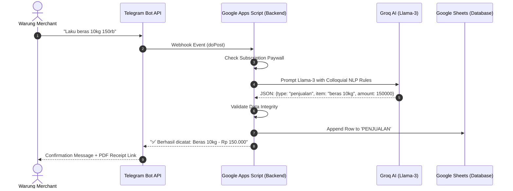

# 📐 LimBot — System Architecture & Blueprint

> **Master Architecture Blueprint — V16 Enterprise**

---

## 1. Product Identity & Business Model

* **Product Name**: LimBot
* **Category**: Software-as-a-Service (Micro-SaaS) — Digital POS & Bookkeeping System for Micro-Retail
* **User Interface**: Telegram Bot API
* **Database & Reporting**: Google Sheets (Automated Multi-Tenant Clones)
* **Natural Language Engine**: Groq Cloud API (Meta Llama-3 / Llama-3.3 70B)
* **Target Audience**: Micro-retailers, neighborhood grocers (*warung sembako*), agents, and local shops.
* **Economic Model**: Subscription-based SaaS (Zero hosting overhead).

### Architectural Stack
1. **Provisioning Engine (`LimBotFactory.js`)**: Node.js automated factory orchestrating `@google/clasp` to provision and deploy serverless instances in seconds.
2. **Serverless Backend (Google Apps Script)**: High-availability webhook receiver running on Google Cloud infrastructure.
3. **Conversational NLP Layer**: Parses informal Indonesian dialect and commercial slang into strictly typed JSON transaction models.
4. **Autonomous Supply Chain Agent (`AgentOtonom_Stok.js`)**: Real-time stock ledger, SKU normalization, safety stock monitoring, and automatic PO generation.

---

## 2. Core Functional Capabilities

1. **Colloquial NLP Parsing**:
   Detects transaction intent automatically without requiring rigid syntax:
   * *Sales (Income)*: `"Laku beras 10kg 150rb"`
   * *Procurement (Expense)*: `"Bayar sales indomie 50rb"`
   * *Receivables / Debt*: `"Bu Ani ngutang telur 20rb"`
   * *Debt Settlement*: `"Bu Ani lunas telur 20rb"`
2. **Real-Time Financial Dashboard**:
   Transactions stream directly into client-owned Google Sheets equipped with automatic gross profit calculation, expense tracking, and debt ledgers.
3. **Dynamic Receipt Engine**:
   Generates verifiable digital receipt links formatted for customer sharing.
4. **Input Validation & Anomaly Guard**:
   Rejects invalid transactions (e.g., zero values, missing commodity names, or ambiguous phrasing).
5. **Subscription Paywall Lifecycle**:
   Automated expiration checks based on internal script properties with administrative renewal controls.

---

## 3. End-to-End System Workflows

### Flow A: Automated Instance Provisioning (Admin Factory)
1. Administrator executes `node LimBotFactory.js "<TELEGRAM_TOKEN>" "<GROQ_KEY>"`.
2. The factory creates a isolated Google Apps Script project via `@google/clasp`.
3. Injects `TemplateSembako.js` with client credentials.
4. Deploys the web app and links Telegram Webhook automatically.
5. Admin runs `setupAwal` authorization and allocates active subscription days.

### Flow B: Client Onboarding & Self-Healing Database
1. Merchant initiates the bot with `/start` and sets business metadata via `/nota`.
2. Upon the first recorded transaction, the system initiates **Auto-Clone**:
   * Clones the Master Spreadsheet Template into merchant's Google Drive.
   * Purges dummy records (*Auto-Clean*).
   * Sets regional locale to Indonesian (`id`) for currency and date formatting.
   * Returns a confidential financial dashboard URL directly in chat.

### Flow C: Daily Operational Processing
1. Merchant types transaction message in natural language.
2. Webhook triggers Google Apps Script, evaluating merchant's subscription validity.
3. Groq processes the text and extracts semantic entities.
4. Validated JSON writes atomically to appropriate sheets (`PENJUALAN`, `KULAKAN`, `KASBON`).
5. Real-time feedback dispatched back to Telegram.

### Flow D: Paywall & Subscription Renewal
1. System verifies license timestamp on every incoming payload.
2. Expired licenses restrict transaction processing, prompting customer service renewal.
3. Upon payment verification, admin executes `/perpanjang <days> <admin_password>` to extend license validity.
